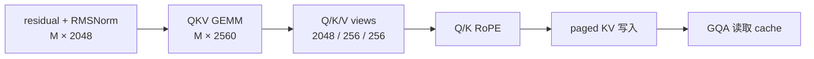

# MiniCPM5-2B：基线复现、函数实现与融合/GQA 优化分析

> 本文保留 2026-10-20 中午的基线与候选中断分析。后续 GQA、融合和调度进展，以及面向天数的逐项算子优化入口，见 [热点算子清单](iluvatar_operator_optimization_backlog.md)；不要把本文的历史“尚未完成”当作最新状态。

核查日期：2026-10-20。环境为单卡天数 BI-V150 32 GiB；分析对象是赛事固定版本的实际运行代码。本文与[真实推理流水线](minicpm_real_inference_pipeline.md)、[16K 调度与 KV 压缩分析](16k_scheduling_kv_compression_analysis.md)配套。

**已完成的结论：官方两组基线完整，4K 总吞吐 2008.97 tok/s，16K 为 917.27 tok/s。RoPE 候选没有完整端到端结果，不能宣称加速。融合方面，先考虑 RoPE + KV 写入和 GEMM 的局部收尾融合；把两条长链各塞进一个 kernel，不能直接推导出性能收益。GQA 已经按共享 K/V 分组计算，优化重点是实际 tile、并行度和混合批次路径。**

下文分别标明“实测”“源码推导”和“待验证方案”。本轮只做数据核验和文档分析，没有启动新的 GPU 测评，也没有运行用户暂缓的 MATH500。

## 1. 先把结果完整性说清楚

### 1.1 运行结果与中断情况

| 阶段 | 完整轮次 | 当前可用结论 |
| --- | ---: | --- |
| 原始基线 4K | 4/4 | 按官方口径舍弃第 1 轮，后三轮可汇总 |
| 恢复后的基线 16K | 4/4 | 同上；与 4K 来自两个服务会话 |
| RoPE 候选 4K | 3/4 | 第 4 轮已启动但没有完成记录；无正式 summary |
| RoPE 候选 16K | 0/4 | 尚未执行 |
| 完整模型精度 | 未执行 | 用户明确暂缓 |

检查时原 coordinator、服务和归档进程均已不存在。服务最后一条带时间的统计日志为 **10 月 20 日 00:00:55**；当前容器 PID 1 启动于 **12:20:34**，说明执行环境已重新启动。现有日志没有留下明确退出异常，不能进一步断言是 OOM、算子错误、定时停机或用户关机。当前宿主机 uptime 也不能当作容器存活时间。

因此昨晚的“自动完成后推送”没有发生：实验和归档进程一起消失，最后一次本地快照保留到了 00:00:45。此次已经重新执行一次归档，把实验标为未完成/失败，保留原始状态；没有篡改原 CSV、补造第 4 轮或拼出候选平均成绩。`nohup` 可以应对 SSH 断开，不能跨容器停止继续运行。

证据：[中断核查](../experiments/EXP-0004/artifacts/analysis_20261020/interruption_check.json)、[归档结果](../experiments/EXP-0004/RESULTS.md)、[基线与候选原始 CSV](../experiments/EXP-0004/artifacts/analysis_20261020/results/)。

### 1.2 基线每一轮，而非只选最好一轮

| 负载 | 轮次 | 用于汇总 | 时长 s | total tok/s | output tok/s | mean TTFT ms |
| --- | ---: | --- | ---: | ---: | ---: | ---: |
| 4096 / 1024 / 64 / 256 | 1 | 否 | 806.48 | 1625.24 | 325.05 | 13842.30 |
| 同上 | 2 | 是 | 663.16 | 1976.47 | 395.29 | 11724.37 |
| 同上 | 3 | 是 | 648.42 | 2021.41 | 404.28 | 11634.00 |
| 同上 | 4 | 是 | 645.99 | 2029.02 | 405.80 | 11616.61 |
| 16384 / 1024 / 64 / 128 | 1 | 否 | 2491.36 | 894.38 | 52.61 | 607581.94 |
| 同上 | 2 | 是 | 2428.43 | 917.56 | 53.97 | 597557.93 |
| 同上 | 3 | 是 | 2428.88 | 917.39 | 53.96 | 597846.83 |
| 同上 | 4 | 是 | 2430.24 | 916.87 | 53.93 | 598012.90 |

四元组依次是输入长度、输出长度、客户端最大并发、总请求数。原始记录中每轮 4K 均完成 256 个请求、1,048,576 输入 token、262,144 输出 token；每轮 16K 均完成 128 个请求、2,097,152 输入 token、131,072 输出 token，均为 SUCCESS。

| 官方汇总指标：后三轮算术平均 | 4K | 16K |
| --- | ---: | ---: |
| 总吞吐 total tok/s | **2008.97** | **917.27** |
| 生成吞吐 output tok/s | 401.79 | 53.95 |
| 单轮时长 s | 652.52 | 2429.18 |
| Mean TTFT ms | 11658.33 | 597805.89 |
| P99 TTFT ms | 70082.53 | 1158461.80 |
| Mean TPOT ms | 147.38 | 486.77 |
| P99 ITL ms | 753.46 | 3300.22 |
| total tok/s 样本变异系数，n=3 | 1.414% | 0.039% |

P99 这一行是三个轮次各自 P99 的平均值，不是把所有请求合在一起重新计算的总体 P99。CV 使用样本标准差/均值，只描述这三轮，不是置信区间，也不自动等于赛事“1%”规则的判定方式。4K 波动大于 1%，后续接近 1% 的改动不能仅凭一次 A/B 就下结论。

统计脚本重新检查轮数、成功数、token 总数和汇总数值，输出[可复核统计 JSON](../experiments/EXP-0004/artifacts/analysis_20261020/analysis_statistics.json)。基线汇总按每轮 throughput 平均，不能换成“总 token / 平均时长”后冒充同一统计口径。

### 1.3 RoPE 当前数据能说明什么

候选完成的 4K 三轮 total tok/s 为 1777.06、1979.17、1944.67。舍弃第 1 轮后暂时只有两个有效样本，均值 1961.92，比完整基线汇总约低 2.34%。**这只是未完成实验的诊断信号：尚无端到端正收益证据，也不足以宣布稳定回退 2.34%。**

此前编译后 RoPE 微基准中，M=64 的 native 约 12.69 μs，候选约 2.47 μs；这不能替代整模测评。候选引入 custom op、独立 Q/K 输出和新的编译边界，可能减少局部计算又增加其他开销；具体原因需要设备时间线。候选与基线的 KV 容量还分别为 523,296 和 521,936 token，应记录这一约 0.26% 差别，而不是默认内存布局完全相同。

## 2. 如何复现同一基线

| 条件 | 固定值 |
| --- | --- |
| 推理插件 | `13eb9be69ecc5b5ca4f79c44e9ee40081eaa1bf0` |
| FlagGems | v5.3.5，`a7620cc191a0b42e040194622c5758b22a7a25dc` |
| vLLM / torch / Triton | 0.24.0+empty / 2.10.0+corex.4.5.0 / 3.6.0 |
| 模型 | 本地 MiniCPM5-2B，实际 `LlamaForCausalLM`；42 层；BF16 |
| GPU / 并行 | BI-V150 32 GiB；TP=PP=DP=DCP=1 |
| benchmark SHA256 | `0813eba574e9d1eb50c297c515baa426da1bcb61ce8c78a398b482f246005565` |
| 输入 | 官方脚本的 `random` completion 负载，非聊天数据集、非 MATH500 |

在相同镜像和 checkpoint 上，先核对 Git SHA、导入位置、脚本哈希；两个环境轮流运行，保证没有其他 GPU 作业。不修改当前工作树来“临时切基线”，使用原始基线目录即可。

```bash
export PYTHONPATH=/workspace/vllm-plugin-FL:/workspace/FlagGems/src
export VLLM_PLUGINS=fl
vllm serve /workspace/MiniCPM5-2B \
  --port 9031 \
  --compilation-config '{"cudagraph_mode":"FULL_DECODE_ONLY"}' \
  --served-model-name minicpm \
  --gpu-memory-utilization 0.85 \
  --max-model-len 131072
```

服务 ready 后，在独立终端运行未修改的官方脚本：

```bash
python3 /workspace/vllm-plugin-FL/benchmarks/benchmark_throughput_serve.py \
  --model /workspace/MiniCPM5-2B --served-model-name minicpm --port 9031 \
  --test-cases '[[4096,1024,64,256],[16384,1024,64,128]]'
```

必须显式给出这两组 `--test-cases`，不能用脚本默认列表替代比赛配置。脚本每组运行 4 次、排除首轮，并调用带 `--dataset-name random --ignore-eos --endpoint /v1/completions` 的 `vllm bench serve`。首轮排除不能改成“只跑一轮预热请求”。本次保存了基线 4K 的完整四轮，并另启服务恢复 16K 四轮；它是完整用例数据，但不是一口气在一个服务进程中完成的 A/B。接近噪声水平的结论仍需后续独立重复。

复核已有结果无需 GPU：

```bash
python3 scripts/analyze_baseline_evidence.py \
  experiments/EXP-0004/artifacts/analysis_20261020
```

## 3. 从函数调用找到每个真实实现

以下 `vllm/` 相对 `/usr/local/lib/python3.12/site-packages/`；`vllm_fl/` 相对固定插件目录。行号以已安装文件为准，不以网上最新分支替代。[原流水线源码哈希](../experiments/EXP-0004/artifacts/pipeline/source_index.json)与[本次补充源码哈希/摘录](../experiments/EXP-0004/artifacts/analysis_20261020/source_excerpts.md)可交叉核查。

| 环节 | 具体函数与文件行号 | 本次行为 |
| --- | --- | --- |
| HTTP | `completion/api_router.py:46` → `OpenAIServingCompletion.create_completion`，`completion/serving.py:129` | completion 校验、输入处理、流式输出 |
| 请求入引擎 | `AsyncLLM.generate:524`、`add_request:280`、`_add_request:400` | 发到 EngineCore，并注册输出收集器 |
| 调度/执行循环 | `v1/engine/core.py:479`，`step`；`:519` 异步 batch queue | schedule → execute/sample → 更新状态 |
| token 与 KV 预算 | `Scheduler.schedule`，`v1/core/sched/scheduler.py:388`；`KVCacheManager.allocate_slots:244` | 运行队列、等待队列、chunk、block 分配 |
| GPU 输入 | `ModelRunnerFL._prepare_inputs`，`worker/model_runner.py:1951`；slot mapping `:2189` | token、绝对位置、query 起点、block table |
| 模型调用 | `ModelRunnerFL.execute_model:4125`；`LlamaModel.forward`，`models/llama.py:392` | embedding → 42 层 → final norm |
| 层内 residual | `LlamaDecoderLayer.forward`，`llama.py:313` | 分开携带 hidden 与 residual，在 norm 合并 |
| Norm | `RMSNorm.forward_native`，`layers/layernorm.py:74` | `ir.ops.rms_norm` 或 `fused_add_rms_norm.maybe_inplace` |
| Norm 数学实现 | `vllm/ir/ops/layernorm.py:10` 的 `rms_norm`；`:40` 的 `fused_add_rms_norm` | 平方均值、加 epsilon、rsqrt、归一化及权重；本次 IR priority 为 native |
| QKV | `LlamaAttention.forward`，`llama.py:224`；`QKVParallelLinear`，`linear.py:914` | 一次合并投影，split `[2048,256,256]` |
| 线性底层入口 | `UnquantizedLinearMethod.apply`，`linear.py:217` → `utils.py:332` → `default_unquantized_gemm:92` | 当前非 ROCm/CPU 分支走 `F.linear`；设备 GEMM 待 profiler 确认 |
| 基线 RoPE | `RotaryEmbedding.forward_native`，`rotary_embedding/base.py:159` | cos/sin 索引、Q/K 旋转；Inductor 可继续融合 |
| Attention backend 选择 | `vllm_fl/dispatch/backends/flaggems/flaggems.py:153` | 未开启专门 FlagGems attention 开关时返回 TRITON_ATTN |
| KV 写入 | `TritonAttentionImpl.do_kv_cache_update`，`triton_attn.py:724` → `triton_reshape_and_cache_flash` | 根据 slot mapping 写 paged K/V |
| GQA | `TritonAttentionImpl.forward:530` → `unified_attention:780` → `kernel_unified_attention:179` | 共享 KV head 的 Q 分组计算；2D/3D 路径 |
| O projection | `LlamaAttention.forward`，`llama.py:233`；`RowParallelLinear.forward`，`linear.py:1628` | TP=1，没有逐层 TP all-reduce |
| MLP | `LlamaMLP.forward`，`llama.py:118` | 合并 gate/up → SiLU-and-mul → down |
| SwiGLU | `SiluAndMul.forward_native`，`layers/activation.py:138` | 前半 gate 的 SiLU × 后半 up |
| 末尾 norm | `LlamaModel.forward`，`llama.py:430` | hidden + residual，最终归一化 |
| logits / sample | `ModelRunnerFL` 的 `logits_indices:2231`、hidden 选择 `:4435`、`sample_tokens:4504`；`v1/sample/sampler.py:72` | 只选择所需采样位置，再做 LM head 和采样 |

实际模型为 hidden=2048、intermediate=6144、Q heads=16、KV heads=2、D=128、词表=130560，完整 NeoX RoPE。checkpoint 名称中的 MiniCPM 不意味着当前执行 `minicpm.py`。

**现有融合必须先扣除：**合并 QKV 与合并 gate/up 已存在；split/view 通常只是元数据与别名，不是三个 GPU 拷贝；残差采用延后相加，编译图中已有 add+RMSNorm。基线图有 168 个线性表达式、42 个 attention、42 个 KV update、84 个 fused add-norm 和 1 个独立 RMSNorm。这是图节点计数，不是 kernel launch 数；native SiLU、乘法、RoPE 也可能被 Inductor 融合。

## 4. 第一条链：RMSNorm → QKV → split → RoPE → KV cache

令 M 为本次 forward 的 token 数。prefill 的 M 与纯 decode 不同，且还可能有 Graph padding。



### 4.1 分段融合的可行性

| 组合 | 能否做 | 真正可能省掉什么 | 主要约束 |
| --- | --- | --- | --- |
| split + RoPE | 可直接按 QKV 偏移寻址；split 本身近乎无设备成本 | 无需把 Q/K/V 复制成三块连续张量 | 必须支持跨 token stride、QKV 共享存储及 V 不变 |
| **RoPE + KV update** | **优先原型** | 少一次 launch，K 旋转结果可直接写 cache，减少临时 K 读写 | slot mapping、无效/padding slot、缓存副作用和依赖顺序 |
| QKV GEMM + RoPE | 可作为 GEMM epilogue 研究 | 减少投影输出中间读写和 launch | NeoX 的两个半 head 通道必须配对；跨输出 tile 配对会增加同步/寄存器成本 |
| QKV GEMM + RoPE + KV 写入 | 可研究，适合固定 D/布局专门实现 | 把 K/V 最终结果直接 scatter 到目标 cache | scatter 破坏连续 store；GEMM tile 与 slot 写入粒度不一致 |
| RMSNorm + QKV GEMM | 数学上可合并，实现收益不确定 | normalized activation 的落地与读取 | norm 需要完整 2048 维 reduction；多个 GEMM 输出 tile 会重复 norm 或需要同步 |
| 整条单 kernel | 原理上存在 persistent/协作实现空间，当前不优先 | 中间张量和 launch | reduction、矩阵乘、RoPE 配对、paged scatter 同时约束 tile；容易损失 GEMM 效率 |

RoPE+KV 这一段在本地 vLLM **已有抽象接口**：`compilation/passes/fusion/rope_kvcache_fusion.py:46` 获取 forward context，调用 backend 的 `do_rope_and_kv_cache_update`；`:440` 仅为声明支持的 backend 注册匹配。`TritonAttentionImpl.fused_rope_kvcache_supported:770` 当前依赖 ROCm AITER，不能据此宣称天数环境已融合。可以借用接口和 dependency 设计，但需要天数实现与实际匹配验证。

现有 EXP-0004 的 functional RoPE custom op 还可能遮住原本基于 native RoPE 的 pattern matcher；新增融合不能只加一个 kernel 就结束。应核对实际编译图是否变成一次 fused op，是否仍保留第二次 KV update，以及 fallback 是否继续经过原 dispatch。

### 4.2 建议的最小融合边界

保留已经调优的 QKV GEMM，先做：

```text
fused_rope_cache(QKV_view, positions, cos_sin, slot_mapping, K_cache, V_cache)
  1. 读取原 Q/K 对，计算完整 NeoX 旋转；
  2. 输出旋转后的 Q；
  3. 把旋转后的 K 和原 V 写入当前层正确的 cache slot；
  4. 通过编译器可见的依赖，保证后续 attention 在写入完成后读取。
```

这是接口草案，不是已完成实现。若采用原接口的原地 Q/K 语义，必须声明 mutation/alias，并保持 QKV 共享存储安全；若只输出 Q、K 直接落 cache，则需要调整消费者契约，不能假装 K tensor 仍然存在。捕获 CUDA Graph 后，缓冲区地址和 metadata 生命周期要稳定。

只消除 K 中间存储的理想节省约为每 token、每层 `256 × 2 bytes × 2（写+读）=1024 bytes`；是否真的省到这部分取决于基线 lowering。它不会消除 attention 对 16K 历史 cache 的读取，更不会改变 KV 容量。不要用这个融合解释 16K 排队的根治。

RMSNorm 可写成 `r(x) × x × γ`。把 γ 折入权重、把 r 移到 GEMM 输出在实数代数上成立，但 BF16 中归一化输出、权重转换和 GEMM 的舍入顺序会改变；不能当作无误差代换。优先保留原数学路径，用融合消除访存，再单独核验数值。

## 5. 第二条链：residual + RMSNorm → gate/up → SwiGLU → down → 下一层 norm

```text
hidden, residual = post_attention_layernorm(hidden, residual)
gate_up = GEMM(hidden, W_gate_up)        # [M,12288]
z = SiLU(gate_up[:,:6144]) * gate_up[:,6144:]   # [M,6144]
hidden = GEMM(z, W_down)                # [M,2048]
hidden, residual = next_input_norm(hidden, residual)
# 最后一层则进入 final norm
```

| 组合 | 当前情况与判断 |
| --- | --- |
| residual add + RMSNorm | 基线已有该语义及 IR 节点；可以针对天数优化其 lowering，但不能重复申报为新增融合 |
| gate + up projection | 基线已用 `MergedColumnParallelLinear`；不是两次 GEMM |
| **gate/up GEMM + SwiGLU** | 值得研究 paired epilogue：同一 tile 同时得到对应 gate/up，直接写 `[M,6144]`，避免 `[M,12288]` 中间张量；代价是重排权重/tile 和更高 accumulator 占用 |
| SwiGLU + down GEMM | 可在 down 的输入加载阶段算激活，但不同输出 tile 可能反复读取 gate/up、重复 SiLU；需与前一种策略实测比较 |
| down GEMM + residual add | epilogue 较自然，但 residual 状态必须一起维护；基线 norm 已经把 add 融入，移走后不一定净赚 |
| down GEMM + residual + 下一次 RMSNorm | norm 需要 down 输出全部 2048 维；当输出由多个 CTA/tile 产生时需要跨 tile reduction，不能无条件写成局部 epilogue |
| 全 MLP 加下一层 norm | 两个依赖 GEMM、中间非线性和整行 reduction；可探索小 M persistent 实现，不宜先用于大 M prefill |

gate/up epilogue 的关键不是把两个不相邻区间各做一次 SiLU，而是同一执行块拿到相同 intermediate index 对应的 gate 与 up 后再相乘。对本模型每 token 有 6144 对中间值；在寄存器里保存所有对会显著增加资源占用。小 M decode 与大 M prefill 应分别设计，不能只用 M=1 的微基准决定全模型路径。

若把 down 的 residual 提前加到结果中，下一层应改用 plain RMSNorm，并让 residual 携带“已相加”的值，否则会重复加两次。最终层也有同样问题。所有跨层融合都要检查第一层 residual=None、一般层和最后一层三种边界。把“下一层/final norm”融合进去，不等于融合整个下一层 decoder。

还要保留数值语义：当前 native fused add-norm 先用 FP32 相加，norm 读取该 FP32 和，另将 residual 转回原 dtype。若 epilogue 先把和落成 BF16，再做 plain norm，就引入了新的舍入位置；仅保证“不重复加”仍不够。

## 6. GQA 的具体内核到底做了什么

### 6.1 找到共享关系，而不是猜测 repeat_kv

真实路径由环境、selector、编译图和安装源码交叉还原为 `TritonAttentionImpl → unified_attention → kernel_unified_attention`。日志中的 `default.flagos` 是选择器标签，不是 GPU kernel 名。尚无正在运行进程的 `type(layer.impl)` 插桩或设备 profiler 轨迹，因此 backend 路径是强源码证据，具体设备 launch 耗时仍待测。

核心代码位置为 `vllm/v1/attention/ops/triton_unified_attention.py:856–863,288–323`：

```text
num_queries_per_kv = num_query_heads // num_kv_heads   # 16 // 2 = 8
kv_head_idx = program_id(1)
query_pos = q_block_local_idx * BLOCK_Q + offs_m // 8
query_head = kv_head_idx * 8 + offs_m % 8
```

也就是 Q head 0–7 访问 KV head 0，Q head 8–15 访问 KV head 1。K/V cache 仍是两个 head，没有先显式扩展成十六个 head 的 `repeat_kv` 大张量。一个 program 内的多个 query row 复用同一 KV tile。

### 6.2 本模型对应的分块参数

由固定源码和模型形状推导，非量化、非特殊 Gemma 分支：

| 项目 | 值或条件 |
| --- | --- |
| `BLOCK_M` / `BLOCK_Q` | 16 / 2；M 轴同时编码 query token 与组内 Q head |
| 2D 的 KV tile | 32；实际代码在 2D 路径选择 `TILE_SIZE_PREFILL`，即使其中含 decode 请求 |
| 3D 的 KV tile | 16 |
| 2D grid | `(floor(M/2)+num_seqs, 2)`；为免 CPU 同步使用上界，部分 program 提前返回 |
| 3D grid | 同上再乘 softmax segments |
| 3D 默认 segments | 16，位于 `triton_attn.py:55` |
| 3D sequence 阈值 | `128 / num_kv_heads = 64`，对齐最近 capture size；当前 capture 列表包含 64 |
| 进入 3D | 有预分配中间缓冲区、`max_seqlen_q <= 1`、序列数不超阈值、未启用 batch invariance |
| 3D 后处理 | `reduce_segments:663`，合并各段 softmax 统计和输出 |

因此约 30 条长上下文纯 decode 按这些条件走 3D split-K 路径；一旦批次中混入 query length>1 的 prefill，整个该 attention 调用走 2D 路径。这是代码条件的推论，不是已经采集的每一步路径占比。

`kernel_unified_attention:407` 从 block table 找物理页；`:513–566` 完成 QK、causal mask、在线 softmax、PV。3D 把长历史切段，最终用各段的 max、exp-sum 和 partial output 做稳定归并。它已经融合了 attention 的主要计算，不能再把“QK+softmax+PV 融合”当作从零新增的优化。

### 6.3 优化候选及优先级

| 优先级 | 方向 | 本模型为什么值得试 | 必须测什么 |
| --- | --- | --- | --- |
| 高 | 天数上的 KV tile、warps、stages、分段数调优 | D=128、Q:KV=8:1、长 L、低至约 30 条 resident 请求；通用参数未必最合适 | 纯 decode 的 4K/16K 到 17K，多种 B；prefill 与混合批次不能回退 |
| 高 | 更有效的 prefill 分块/组内复用 | 当前 `BLOCK_Q=2`，长提示 query 块很多；增大 query tile 可增加 KV 复用 | 寄存器、spill、occupancy、causal 边界、真实吞吐 |
| 中高 | 将混合批次中的 decode 与 prefill 分别派发到合适 attention kernel | 当前一个 prefill 可令全部请求失去 3D 路径 | 多一次 launch/索引准备是否抵消收益；保持 token 输出次序 |
| 中 | 对 decode 固定 query_len=1 简化 grid 和序列查找 | 当前 upper-bound grid、通用 query 映射有空 program/分支 | 必须支持 Graph padding、变长 cache 与空 slot |
| 中 | 更合理的 segments 阈值和静态 workspace | 固定 16 段未必同时适合 4K、16K、B=1 和 B=64 | 少段并行不足，多段归并/临时访存增多；Graph 不能依赖主机读取实时长度 |
| 后续 | cache layout 与 RoPE+cache 联合设计 | 可减少新增 KV 写入开销，改善合并访存 | 不能把 K/V 按 Q heads 复制，破坏 GQA 的容量优势 |

不建议先切换 attention backend 开关然后把差值当作算子优化。应在已有 dispatch 下实现天数专门路径，明确 fallback，并保持官方测试条件。

作为数量级分析，每个 decode token 的 42 层四类线性计算约 3.96 GFLOPs；16K 历史的 QK+PV 约 5.64 GFLOPs，均不含其他操作。GQA 减少 K/V 存储，不会把 16 个 Q head 的 QK/PV 工作也缩成两个 head。FLOPs 不是实际耗时；真实瓶颈还取决于带宽、tile 复用、设备执行效率和主机开销。

## 7. 下一轮如何验证，而不再把局部加速当整模结论

1. **先恢复可比较的 RoPE A/B。** 原候选第 4 轮被打断，后续应在新服务会话完整重跑候选两组四轮，原数据保留；基线跨会话条件写清。若收益接近 4K 波动，再安排相邻基线复核。
2. **先采集热点证据。** 独立诊断记录每步 prefill/decode token 数、attention 2D/3D 分支、Graph replay、算子 GPU 时间、GEMM 名称和 KV 写入时间。profiling 开销不能混入官方结果。
3. **一次只改一个融合或 kernel 策略。** 首选 RoPE+KV 写入或 GQA 参数专门化；继续保留 dispatch、fallback、编译和 Graph 支持。
4. **数值与运行检查仍必要。** GQA 要覆盖非连续 Q、不同 seq_len、causal chunk、paged 边界、空/padding slot、共享 KV group；融合要覆盖别名和 residual 边界。完整任务精度按用户安排暂缓，但没有它就不能宣称最终赛事精度达标。
5. **最终回到原官方参数。** 每组 4 轮排除第 1 轮，报告 total/output tok/s、TTFT、TPOT、ITL、失败数和波动。PR 保持 LeanScale 格式，未完成性能/任务精度的工作保持草稿状态。

建议顺序是：完成数据闭环 → 定位 attention/调度占比 → 实现局部融合与 GQA 专门化 → 再评估跨 GEMM 的大型融合。这个顺序来自当前可见的容量、源码与未完成 A/B，而不是对尚未测量的收益作承诺。
