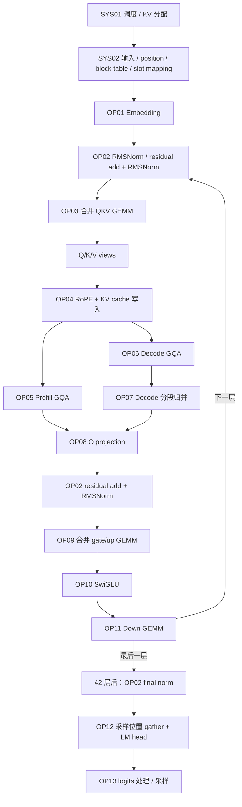

# MiniCPM5-2B 天数芯片热点算子与逐项优化清单

建档日期：2026-10-20。对象：单卡 Iluvatar BI-V150、BF16、MiniCPM5-2B 的真实
`LlamaForCausalLM` 推理路径。本文作为后续逐项优化的工作清单，算子编号保持稳定；
每个新实验把编号、方案、代码提交、原始结果和结论回填到本文及对应 `EXP-xxxx`。

**2026-10-23更新：已完成当前选定版本EXP18的分阶段GPU profiling；最新结论见本文末尾及[新报告](operator_profile_4k_20261023.md)。以下2026-10-20建档内容保留为历史快照，不代表当前实验状态。** 下文区分“已有实测依据”
与“依据形状和调用路径列出的热点候选”，优先级表示下一步排查顺序，不冒充耗时排名。
这次只核查源码、已有日志和实验结果，没有改动运行中的代码或插入 GPU profiling。

配套阅读：[真实推理流水线](minicpm_real_inference_pipeline.md)、
[基线与融合分析](baseline_fusion_gqa_analysis.md)、
[长文调度与 KV 压缩](16k_scheduling_kv_compression_analysis.md)。
最新函数行号、源码 SHA256、模型形状和接入证据见
[本次只读索引](evidence/operator_hotspots_20261020/source_index.json)；
历史文档中的行号和阶段性结论应结合各自快照日期阅读。

## 1. 固定版本和已经知道的事实

| 项目 | 本清单核对的版本/状态 |
| --- | --- |
| 引擎与运行时 | vLLM `0.24.0+empty`；PyTorch `2.10.0+corex.4.5.0`；Triton `3.6.0` |
| 原始比赛基线 | 插件 `13eb9be69ecc5b5ca4f79c44e9ee40081eaa1bf0`；FlagGems `a7620cc191a0b42e040194622c5758b22a7a25dc` |
| 当前融合候选 EXP-0006 | 插件 `07d9fa0cfdc5f09db178e29508e3c0bcb5c1e908`；FlagGems `484413ea0db18221dd9e63e742361d837df9ff13` |
| 独立调度候选 EXP-0007 | 插件 `ef63a19a8309c3b3ba686802220883ac2f8836ab`；算子沿用 EXP-0006 |
| 模型 | 42 层；H=2048；I=6144；Q/KV heads=16/2；head dim=128；词表 130560 |
| 实际接入 | EXP-0006 已观察到 42 层 RoPE＋KV 融合与 42 层 GQA，旧独立 KV update 为 0；35 个 FULL decode Graph 和 smoke 通过 |
| 性能快照 | EXP-0005 两组完成；EXP-0006 4K 完成、16K 尚在测；EXP-0007 已通过 CPU 检查、等待正式测评 |

EXP-0005 的 RoPE＋GQA 组合相对原始基线，4K/16K 吞吐分别提高约 22.75%/107.13%。
EXP-0006 4K 为 2686.33 total tok/s，相对原始基线提高 33.72%，相对 EXP-0005
提高约 8.93%。这些是**组合端到端结果**，不能拆成单个算子的贡献。4K 为不同服务
会话对照，EXP-0005/0006 的后三轮 CV 分别约 7.73%/3.64%，不能忽略波动。
完成情况以 [EXP-0005 结果](../experiments/EXP-0005/RESULTS.md)、
[EXP-0006 4K](../experiments/EXP-0006/RESULTS_4096.md)、
[EXP-0006 16K](../experiments/EXP-0006/RESULTS_16384.md) 为准。

## 2. 沿真实流水线给算子编号

令 **M** 为本次模型执行的 token 行数，包含必要的 Graph padding；**S** 为选取的
logits 行数；**B** 为本步活跃请求数；**L** 为各请求的历史长度。
客户端并发 64 不等于 M、S、B 始终都是 64。混合批次包含多个 prefill token
和其他请求的 decode token；下文不能用一个固定 M 代替全部阶段。

该图表示数据依赖，不是 kernel 发射列表。OP07 是分段 decode 的归并，不表示
prefill 结果也必须做同样的数学归并。
OP02 被多处复用：全模型语义上有 1 次 plain RMSNorm 和 84 次 residual add＋
RMSNorm（含最后的 final norm）。这是模型/图层面的计数，**不是 GPU launch 数**。

| 编号 | 操作与逻辑形状 | 频次/阶段 | 证据与优先级 | 天数上下一步要做什么 |
| --- | --- | --- | --- | --- |
| OP01 | Embedding：`[M] → [M,2048]` | 每次模型执行一次 | 形状候选；P2 | 检查实际 gather kernel、非连续输入及 padding；确认耗时后再改加载方式 |
| OP02 | RMSNorm / add＋RMSNorm：`[M,2048]`；epsilon=1e-6 | 全部层与 final norm；两阶段 | 已有 IR 融合，尚无独立时间占比；P1 | 固定 H=2048 的向量加载、每行归约、warps、多个小行处理；与实际 compiled native 对照 |
| OP03 | QKV GEMM：`[M,2048] × W[2560,2048]ᵀ` | 每层一次，共 42 次 | 有 norm＋QKV 原型微基准；P1 | 先测原 GEMM 的小 M/大 M 效率与设备内核，再判断 epilogue 融合 |
| OP04 | RoPE＋新增 KV 写入：Q `[M,16,128]`，K/V `[M,2,128]` | 每层一次，共 42 次 | 已实现、数值/Graph/接入通过；P1，保持回归 | 优化剩余 K 物化、不同 M 的 launch 配置与 cache store；保留 fallback 和单次写入 |
| OP05 | Prefill / mixed 中的多 query GQA：QK、causal mask、online softmax、PV | 每层；长 prefill 与混合批次 | 已接入调优版本；P0 | query tile、KV tile、stages、warps、causal 边界、混合批次映射与空 program 开销 |
| OP06 | Decode GQA：每请求通常 1 个 Q，读取 `[L,2,128]` K/V | 每层；L 随输出增长 | 已接入分段版本；P0 | 在 B≈30/64、L≈4K/16K 及增长区间调 segments、KV tile、并行粒度和 workspace |
| OP07 | split-K/分段 softmax 的 max、sum、partial output 归并 | 分段 decode；每层 | 已存在融合归并 kernel；P0，与 OP06 一起测 | 单独测归并及临时区流量；避免主 kernel 变快而归并更慢；保持 FP32 稳定归并 |
| OP08 | O projection：`[M,2048] × W[2048,2048]ᵀ` | 每层一次，共 42 次 | 形状候选；P1 | 小 M GEMM 效率；考察 residual epilogue 是否比现有 add-norm 更合适 |
| OP09 | gate/up GEMM：`[M,2048] × W[12288,2048]ᵀ` | 每层一次，共 42 次 | 四类层内线性中计算规模最大；融合原型已测慢；P1 | 首先保持现有高效 GEMM，定位瓶颈；只有矩阵乘效率保持时才重试 paired SwiGLU epilogue |
| OP10 | SwiGLU：`SiLU(gate) * up`，`[M,12288] → [M,6144]` | 每层一次，共 42 次 | native 表达式可被编译融合；占比待测；P1 | 6144 对通道的向量加载、连续写出、避免不必要拷贝；检查现有 lowering 后再新增 kernel |
| OP11 | Down GEMM：`[M,6144] × W[2048,6144]ᵀ` | 每层一次，共 42 次 | 形状候选；P1 | 小 M 路径和大 M tile；SwiGLU 输入侧融合、residual epilogue 分别验证 |
| OP12 | hidden gather `[M,2048] → [S,2048]`，LM head `→ [S,130560]` | 每步输出侧一次，非每层 | 大词表候选，尚无单项测量；P1 | 分开计时 gather 与 LM head；检查词表 padding、GEMM、logits 物化，按真实采样需求研究融合 |
| OP13 | 温度/penalty、可选 top-k/top-p、softmax/随机采样或 argmax | 每步输出侧一次 | 实际分支需 metadata/profiler 确认；P1/P2 | 固定真实采样语义，优化词表归约/筛选/临时张量；不能为提速改变 temperature、top-p 或 RNG 语义 |

P0 优先对现有 GQA 做诊断和有依据的局部改进；P1 收集分阶段时间占比后排序；
P2 只有确认存在可见开销后再投入。当前已经安排的融合/调度官方测评继续串行执行，
本清单不启动竞争 GPU 的新任务。

## 3. 每项对应到可修改的源码

路径前缀定义：`V/` 为 `/usr/local/lib/python3.12/site-packages/vllm/`；
`P/` 为 EXP-0006 插件工作区；`G/` 为 EXP-0006 FlagGems 工作区。
这里列的是已安装代码及冻结候选的行号，不链接上游浮动 `main` 代替实际版本。

| 编号 | 上层调用与底层入口 |
| --- | --- |
| OP01 | `V/model_executor/layers/vocab_parallel_embedding.py:472` `VocabParallelEmbedding.forward`；`:77` `UnquantizedEmbeddingMethod.embedding` |
| OP02 | `V/model_executor/models/llama.py:313` `LlamaDecoderLayer.forward`；`V/model_executor/layers/layernorm.py:74` `RMSNorm.forward_native`；`V/ir/ops/layernorm.py:10` `rms_norm` / `:40` `fused_add_rms_norm` |
| OP03 / OP08 | `V/model_executor/models/llama.py:224` `LlamaAttention.forward`，分别调用 `qkv_proj` / `o_proj` |
| OP09 / OP11 | `V/model_executor/models/llama.py:118` `LlamaMLP.forward`，分别调用 `gate_up_proj` / `down_proj` |
| 四类层内 GEMM | `V/model_executor/layers/linear.py:217` `UnquantizedLinearMethod.apply` → `V/model_executor/layers/utils.py:332` `dispatch_unquantized_gemm` → `:92` `default_unquantized_gemm` → `torch.nn.functional.linear`；实际设备 GEMM 名称和时间仍需 profiler |
| OP04 图接入 | `P/vllm_fl/compilation/rope_kv_fusion.py:34` `fuse_rope_kv` → `P/vllm_fl/ops/rope_kv_dispatch.py:17` `rope_kv_dispatch` |
| OP04 计算内核 | `G/src/flag_gems/runtime/backend/_iluvatar/fused/rope_kv_cache.py:71` `rope_kv_cache`；`:9` `_rope_kv`；`:62` `select_rope_kv_config` |
| OP04 未融合回退 | `P/vllm_fl/ops/rotary_embedding.py:28` `RotaryEmbeddingFL.forward_native`；原 KV 写入为 `V/v1/attention/ops/triton_reshape_and_cache_flash.py:344` `triton_reshape_and_cache_flash` |
| OP05 / OP06 | `P/vllm_fl/dispatch/backends/flaggems/impl/iluvatar_gqa.py:58` `IluvatarGQAImpl.forward` → `G/src/flag_gems/runtime/backend/_iluvatar/fused/paged_gqa.py:131` `paged_gqa` → `:14` `_attention` |
| OP07 | 同一 `paged_gqa.py:110` `_reduce` |
| OP10 | `V/model_executor/layers/activation.py:138` `SiluAndMul.forward_native` |
| OP12 | `P/vllm_fl/worker/model_runner.py:4435` 选择 hidden 行；`V/model_executor/models/llama.py:562` `compute_logits` → `V/model_executor/layers/logits_processor.py:89` `_get_logits` → LM head 的 quant method |
| OP13 | `P/vllm_fl/worker/model_runner.py:4504` `sample_tokens`；`V/v1/sample/sampler.py:243` `sample` / `:240` `greedy_sample`；`V/v1/sample/ops/topk_topp_sampler.py:123` `forward_native` |

可直接查看冻结的 [GQA kernel](https://github.com/yyq0210/FlagGems/blob/484413ea0db18221dd9e63e742361d837df9ff13/src/flag_gems/runtime/backend/_iluvatar/fused/paged_gqa.py)、
[RoPE＋KV kernel](https://github.com/yyq0210/FlagGems/blob/484413ea0db18221dd9e63e742361d837df9ff13/src/flag_gems/runtime/backend/_iluvatar/fused/rope_kv_cache.py)、
[融合接入](https://github.com/yyq0210/vllm-plugin-FL/blob/07d9fa0cfdc5f09db178e29508e3c0bcb5c1e908/vllm_fl/compilation/rope_kv_fusion.py)。
基线不是所有算子都调用 FlagGems：RMSNorm 的 IR native、SwiGLU 的 compiled native、
线性投影的 F.linear 都要沿实际 lowering 检查，不能只因插件里存在同名实现就修改它。

采样尤其不能套用固定假设：官方 wrapper 没有显式设置 temperature/top-k/top-p；
当前 completion 请求构造器也没有硬编码 temperature=0。要记录服务默认配置和
实际 `SamplingMetadata`，才能确定 argmax、top-k/top-p、softmax、RNG 哪些分支执行。
即使走 `TopKTopPSampler.forward_native`，也不代表每次都进行了 top-k 和 top-p 筛选。

## 4. 为什么优先排查这些位置

### 4.1 GQA、长历史读取与分段归并

8 个 Q head 共享一个 KV head；当前实现没有先把 2 个 KV head 复制成 16 个。
QK、在线 softmax 和 PV 已在 attention kernel 内完成，不能把“再融合一次
QK＋softmax＋PV”当作新成果。

EXP-0005 已包含 KV tile 调优、prefill query tile 调整，以及混合批次按各序列
query 长度选择合适路径。decode 使用 16 段并行，KV tile 为 32；prefill 的
64 个 query rows 包含 8 个 query token × 每组 8 个 Q head。后续关注 B、L、
prefill/decode 比例变化时的最佳分段数、tile、寄存器和临时区代价，而不是重复
实现现有 head 分组。小 B 的局部退化也保留在
[EXP-0005 诊断](../experiments/EXP-0005/DIAGNOSTICS.md) 中。

还有两个可直接核对的后续切入点：当前 `paged_gqa.py:157` 和 `:159` 总会发射
decode 与归并 kernel，纯 prefill 时各 program 再按 query 长度返回；是否值得
消除这些空 launch 要单独测量，且不能为判断批次类型引入 GPU→CPU 同步。
当前预分配 workspace 和接入检查按 16 段设计，先比较不超过 16 的分段配置；
扩大段数必须同步修改 metadata、容量检查与 Graph 缓冲区，不能只改一个参数。

在每个 KV 元素理想只读一次、忽略额外流量的模型下，单请求 L=16384 的 42 层
K/V 数据合计为 **672 MiB**。这是数据量估算，不是测得的显存流量；实际访问取决于
分块、复用、缓存及重读。GQA 的优化要同时看设备时间与实际流量，不能只看 FLOPs。

### 4.2 GEMM：按实际形状分别优化

以下按矩阵乘 `2*M*K*N` 推导，不包含 attention、激活、norm，也不等于设备耗时。
权重大小按 BF16 计算，不代表每个 token 都从显存重新读取整张权重。

| GEMM | 每层、每个输入 token 的计算量 | 单张权重大小 |
| --- | ---: | ---: |
| QKV | 10.486 MFLOPs | 10 MiB |
| O | 8.389 MFLOPs | 8 MiB |
| gate/up | 50.332 MFLOPs | 48 MiB |
| down | 25.166 MFLOPs | 24 MiB |
| LM head，模型输出端一次 | 每个选中 logits 行 534.774 MFLOPs | 510 MiB，逻辑词表大小 |

42 层四类线性合计约 3.964 GFLOPs/模型输入 token；LM head 按 S 而非 M 计算。
所以 gate/up、down 和大词表 LM head 都应进入热点清单。小 M decode 和较大 M
prefill 需要分别测量，不能用 M=1 的结果替代 M≈30/64 或较大 prefill。
实际词表 padding 和权重 stride 在诊断中另记。

### 4.3 小算子与融合：先扣除已经完成的工作

合并 QKV、合并 gate/up、residual add＋RMSNorm 已存在；`split/view` 通常只是视图，
不能假定消除它们就省掉三次设备拷贝。图中多个 `mul/cat/silu` 也不等于多个 launch。

EXP-0006 已选用 RoPE＋KV 写入融合：保留独立 Q/K 输出，少一次启动和一次 K 读取。
K 输出仍被物化，不能说已经消除所有中间张量。N=64 时原 RoPE＋写缓存约
5.350 µs、融合约 3.513 µs；这是独立微基准，不是单项端到端贡献。

两个更大的融合原型已被实测淘汰，后续重试必须说明新假设：

| 原型 | 工作点 | 原实现 → 最快已测原型 | 当前处理 |
| --- | --- | --- | --- |
| gate/up GEMM＋SwiGLU | M=30 | 110.41 → 151.59 µs | 不接入服务；先解决 GEMM 效率问题 |
| residual＋RMSNorm＋QKV GEMM | M=30 | 24.56 → 118.62 µs | 不接入服务；检查重复 norm 归约与 tile 设计 |

完整配置、失败与数值检查见 [融合选择记录](../experiments/EXP-0006/FUSION_DECISION.md)。
“最优”目前只限定于已经测过的候选，不是所有融合方案的全局最优。

重新做跨 GEMM 融合时，至少保留这些约束：

- RMSNorm 的 FP32 相加/归约与 BF16 舍入位置；不能把 γ 折入权重当作逐位等价。
- down epilogue 提前加 residual 后，下一层不得重复相加；第一层与 final norm 单独检查。
- 完整行归约与 GEMM 输出 tile 的边界；不能未经同步就把下一层 norm 当局部 epilogue。
- KV 地址乘 stride 前使用 int64；分页、负 slot、短映射、共享前缀和 Graph padding 正确。
- 图重写保留 attention 输出缓冲区的副作用；不得重引入 EXP-0006 已定位的通用 DCE 缺陷。

## 5. 单独登记系统热点，避免混入算子结论

| 编号 | 入口 | 当前证据/优化目标 |
| --- | --- | --- |
| SYS01 | `V/v1/core/sched/scheduler.py:388` `schedule`；`:1107` `_preempt_request`；`V/v1/core/kv_cache_manager.py:244` `allocate_slots` | 16K 容量与等待、抢占重算；EXP-0007 正在验证完整输出上界预留，尚无收益结论 |
| SYS02 | `P/vllm_fl/worker/model_runner.py:1951` `_prepare_inputs`；slot mapping / block table / position 构造 | CPU 数组处理、H2D 拷贝、同步和输入缓冲更新；需要时间线区分与 GPU 执行的重叠 |
| SYS03 | Runner 执行与 FULL_DECODE_ONLY Graph replay；输出队列 | 查实际 Graph 命中、padding、主机发射空洞与输出处理；不能将其改善记作某个算子的加速 |

每个存储 token 的 42 层 BF16 KV 为 42 KiB；64×(16384+1024) 约需 44.625 GiB，
超过当前约 20.9 GiB 的 KV 池。只加速写缓存或调整等待队列不会凭空增加容量。
2026-10-20 19:16 的当前 16K 测试快照已观察到 2 次抢占，但不是最终计数，
见 [临时观测](../experiments/EXP-0007/artifacts/parent_16k_partial_observation.json)。

KV 压缩另立实验：真实物理块回收、搬移和 metadata 成本必须计入性能；必须验证
完整缓存对照、官方 MATH500 Level 3，以及确实触发压缩的长文质量。
不能把仅仅 mask 掉 KV 或没有触发压缩的精度结果当作完成。

## 6. 每个算子采用相同的优化与验收流程

1. **确定实际路径。** 记录 op ID、引擎/算子 SHA、dispatch/fallback、编译图与设备
   kernel 名；先确认修改的实现真的被调用。
2. **单独采集诊断。** 从官方负载中采样 prefill、纯 decode、mixed 的真实 M/B/L、
   stride、padding 和采样 metadata。GPU profiling 与官方计时分开且串行。
   保存可用的设备时间线、kernel 调用数、独占时间、拷贝/同步、资源使用和流量；
   没有可用计数器的项目明确写“未采集”，不编造占比。
3. **建立形状矩阵。** decode 覆盖 B=1/8/16/30/32/64，L=4096/5120/16384/17408；
   线性/逐元素覆盖 M=1/8/30/32/64/128/256/512/1024/2048，并加入实际观测到的
   prefill 形状与 32/33、128/129 等分段边界。先用真实分布决定主工作点。
4. **一次改一个假设。** 在天数上实际比较 tile、warps、stages、分段数、加载/存储
   和融合边界，保存全部结果；不直接照搬其他设备上的最佳配置。
5. **先检查正确执行。** 无损算子做数值、空输入、stride、分页、别名、
   CUDA Graph 改变输入后的重放和 fallback 检查。采样相关改动还检查分布、
   随机数状态和 tie 行为。完整任务精度可按用户要求暂缓，不能据此宣称赛事达标。
6. **交错微基准。** 预热后同进程 A/B，固定输入、重复采样，记录波动、异常和失败；
   主 kernel 与归并/索引/搬移成本合计报告，不能只计融合中变快的一半。
7. **回到官方端到端。** 原 serve 参数、原 benchmark 脚本；
   `[4096,1024,64,256]`、`[16384,1024,64,128]` 各四轮、弃首轮。
   对比紧邻父版本及原始基线，报告 total/output tok/s、TTFT、TPOT/ITL、失败、
   抢占与排队。接近噪声的差值安排复核，不只选最好轮次。
8. **回填结论。** 接入、保留候选、淘汰或待复核均记录；GPU 时间占比用同一阶段的
   独占计时口径，不能累加有重叠的 CPU/GPU inclusive 时间后称为总占比。

后续每个算子的记录采用下表；空白项保留“待测”，不从 FLOPs 或整模收益反推：

| 字段 | 待填写内容 |
| --- | --- |
| 算子 ID / EXP 编号 | 例如 OP06 / 新建 EXP-xxxx |
| 形状与阶段 | M、B、L、dtype、stride、prefill/decode/mixed、Graph 状态 |
| 实际接入 | 源文件/函数、设备 kernel、fallback、引擎与算子提交 |
| 时间证据 | 基线/候选 µs、调用数、阶段 GPU 独占时间占比、采样窗口 |
| 优化假设 | 消除什么访存/启动/重复计算；增加了什么资源或准备成本 |
| 检查 | 数值、生命周期、Graph、精度状态及原始结果路径 |
| 官方收益 | 两组后三轮结果、波动、失败数及系统指标 |
| 决策 | 接入 / 淘汰 / 待复核；原因与下一步 |

## 7. 当前待办与已有结果

- [x] 固定真实流水线、形状、源文件/函数与哈希，建立 OP01–OP13、SYS01–SYS03 清单。
- [x] OP05–OP07：EXP-0005 已完成一版 GQA/mixed 调优和两组官方测评；进一步调优须用新的诊断证据。
- [x] OP04：EXP-0006 融合内核与 42 层真实接入通过，4K 官方结果完整。
- [ ] OP04：完成 16K，汇总融合增量及波动；以结果文件的完整性检查为准。
- [ ] SYS01：完成 EXP-0007 的真实服务与官方测评，再决定是否保留 KV 增长预留策略。
- [ ] 独立采集当前最佳可行版本的分阶段算子时间线，补齐所有候选的时间占比。
- [ ] 按实测占比依次推进 OP03/08/09/11/12 的 GEMM、OP02/10 的小算子及 OP13 采样优化。
- [ ] 在独立实验中评估 KV 压缩的物理回收、性能及精度，达标后再纳入最终方案。

复查本次源码清单：在实验仓库执行 `python3 scripts/collect_operator_inventory.py`。
它只读取源码、配置和已有实验文件，不导入 PyTorch、不加载模型、不占用 GPU；
重新执行会更新该日期目录的快照，应通过 Git 保存每次更新。

## 4K 全模型采集任务：EXP-0008

2026-10-20 已按用户要求安排独立 profiling，等待当前 EXP-0006 16K 完成归档后执行，再恢复 EXP-0007。使用官方 4096/1024/64/256 请求集，分别采集 FULL_DECODE_ONLY 和用于算子归属的 NONE 模式，保留实际 batch/phase/padding、GPU kernel 时间和 worker CPU self time。当前没有新耗时结论。

[采集方案与脚本](../experiments/EXP-0008/README.md) · [队列状态快照](../experiments/EXP-0008/STATUS.json)。结果将保存到 experiments/EXP-0008/RESULTS.md；原始 trace 留在服务器，摘要与哈希自动推送。内核名称或相关性不足时保留未归属，不强行将 GEMM 分配到某个线性层。该采集仅覆盖 worker 的 CPU 活动，不能当作整个调度器进程的 CPU profile。

## 2026-10-21：首次恢复的 4K 实测热点

EXP-0009 恢复了昨晚 EXP-0008 的三个原始 trace。FULL_DECODE_ONLY 的 steady 窗口实际为 16 个 mixed 迭代：GQA 54.58%、gate/up 20.33%、down 10.54%、QKV 4.40%、O 3.52%、SwiGLU 1.99%、norm 1.95%、RoPE+KV 0.49%。百分比是该窗口可见 kernel 总工作量占比，不是整轮或请求时延占比。纯 decode 的 Graph 内部 kernel 未被当前 profiler 捕获，不能按外围算子占比排名。后续优先细分 prefill/decode GQA 内核，再看 gate/up 与 down GEMM；完整记录和 CSV 见 [恢复与补测记录](restart_20261021.md) 及 [逐窗口数据](../experiments/EXP-0009/artifacts/recovered_20261020/RESULTS.md)。

## 2026-10-21：GQA 实现专项分析

NONE/late 的 16 个纯 decode 迭代已逐步核验：每步42次主 attention 和42次 reduce。B64、CPU上下文上界4618–4761；主 kernel 平均1672.156 μs，占全部可见kernel时间78.340%，reduce平均20.395 μs，占0.955%。实际 launch 256线程、111 registers/thread、20 KiB shared memory。此结果来自诊断窗口，不是生产Graph或官方吞吐口径。优先测试warp/stage布局、分段选择和分页访存；已有编译IR排除了单纯改写dot累加/exp拼写的新增收益。详见 [GQA实现与优化分析](gqa_optimization_analysis_20261021.md)。

## 2026-10-21：4K profiling 完整收尾与归属复核

两种模式均256/256成功，6个trace已归档。新增按aten::linear权重shape识别LM head、按sample_tokens调用范围统计采样、按固定S16网格拆分GQA prefill/decode分支；所有原始duration保持不变。纯decode诊断：GQA主kernel78.340%，采样7.487%，gate/up4.446%，down2.797%，LM head1.270%。生产配置mixed窗口：GQA prefill42.357%，gate/up20.088%，GQA decode12.444%，down10.411%。Graph内部decode仍不可见。完整调用数、均值、总时间、CSV和口径见 [4K算子耗时报告](operator_profile_4k_20261021.md)。

## 2026-10-23：当前选定版本的4K热点与后续顺序

EXP18两组各256请求全部成功，8个窗口各16步，原始trace/metadata/实际编译缓存已独立复核。FULL配置mixed（实际NONE执行）中prefill45.20%、gate/up23.61%、down12.23%；NONE/B64 decode主核65.78%、采样12.70%；NONE尾部B8–16的四类层内投影约44.54%。这些是各窗口可见kernel总工作量占比，不能合为整程占比。FULL decode Graph内部不可见，不能用外围采样占比给整模排名。

OP05优先开展EXP19的prefill页号广播与K加载布局，固定已选参数；OP03/08/09/11后续针对小M及生产Graph padding研究真实GEMM路径。先前GEMM融合慢原型不直接恢复。当前选择仍EXP16；官方4K/16K、EXP17 ABBA均完成，调度EXP10已由用户拒绝并回退，KV压缩精度工作保持独立。详见[最新报告](operator_profile_4k_20261023.md)与[EXP19假设](../experiments/EXP-0019/README.md)。

## 2026-10-29：EXP25 同日 4K ABBA 已审核

A 均值 3564.105、B 3546.580 tok/s（-0.492%），两相邻配对均未改善（-0.457%/-0.526%）；16 轮、4096 请求全部成功。保持 EXP20，停止推广全局 MLP 权重布局，不把微基准收益当作整模收益。下一步先核实实际采样路径。详见[完整分析](mlp_weight_layout_abba_20261029.md)。

## 2026-10-30：top-p 首组官方4K完成

3688.33 tok/s，相对EXP20历史3579.12为+3.05%；保留3460.50/3771.46/3833.03，CV5.414%，1024请求零失败。真实模型96次mask/RNG检查通过，正式shadow=0。跨日单会话尚不能确认稳定因果收益，保留EXP20，追加同日关闭开关对照。详见[完整结果与前后思路](topp_row_parallel_e2e_20261030.md)。

## 2026-10-30：top-p 同日关闭开关对照已审核

EXP28 A=3552.79、EXP27 B=3688.33 total tok/s，本次B/A +3.815%；TPOT 84.12→80.86 ms（-3.875%），两组各1024成功/0失败，KV均522256、抢占0。后三轮CV分别5.302%/5.414%，第二到第四轮仍上升约10%；后验B→A单会话对照不等于稳定因果收益。保留EXP20，top-p默认关闭、候选待预登记交错复核；没有追加新GPU试验。独立审核通过，初始控制器导入失败及传输准备问题均保留。详见[同日完整报告](topp_row_parallel_same_day_20261030.md)。
