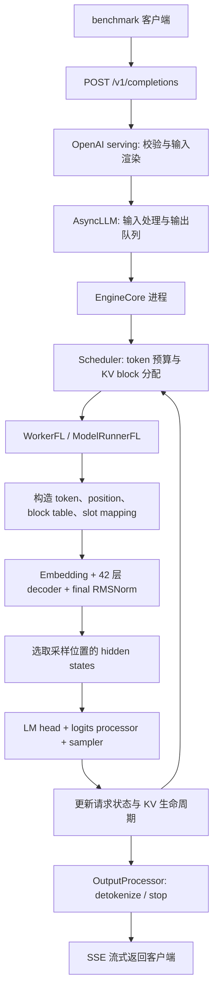

# MiniCPM5-2B 在天数 GPU 上的真实推理流水线

本文解析 LeanScale 当前赛事环境中，一条请求从 HTTP 入口到生成 token 返回的实际执行过程。依据是模型配置、safetensors 权重头、已安装源码、EXP-0003 启动日志和实际生成的编译图。这里的“实际”限定于本次固定版本和启动参数；换模型配置、插件版本或编译选项后，需要重新核查。

最关键的结论是：模型目录名为 `MiniCPM5-2B`，但配置和运行日志均指定 **`LlamaForCausalLM`**，实际执行 `vllm/model_executor/models/llama.py`。它是 42 层、BF16、GQA 的稠密 decoder-only 模型。不能直接用 `minicpm.py` 中的 embedding/depth 缩放逻辑解释当前执行过程。

## 1. 版本、配置与证据边界

| 项目 | 本次实际值 | 证据 |
| --- | --- | --- |
| GPU | 单张 Iluvatar BI-V150，32 GiB | EXP-0001 环境记录 |
| vLLM / PyTorch / Triton | 0.24.0+empty / 2.10.0+corex.4.5.0 / 3.6.0 | 环境快照；vLLM 厂商镜像文件以 SHA256 固定 |
| 推理插件基线 | `13eb9be69ecc5b5ca4f79c44e9ee40081eaa1bf0` | EXP-0003 启动记录 |
| FlagGems 基线 | 官方 v5.3.5，`a7620cc191a0b42e040194622c5758b22a7a25dc` | EXP-0003 启动记录 |
| 模型架构 | `LlamaForCausalLM`，`model_type=llama` | config、启动日志、编译图三者一致 |
| 精度 / 并行 | BF16；TP=PP=DP=DCP=1；无量化、无 speculative decoding | 运行配置 |
| 调度 | V1 engine；异步调度；chunked prefill 和 prefix caching 启用 | 启动日志 |
| 编译 | Inductor，`custom_ops=['none']`，`FULL_DECODE_ONLY` | 最终生效配置与捕获日志 |

[模型与权重形状证据](../experiments/EXP-0004/artifacts/pipeline/model.json)、[运行证据](../experiments/EXP-0004/artifacts/pipeline/runtime.json)、[安装源码索引与哈希](../experiments/EXP-0004/artifacts/pipeline/source_index.json)、[编译图统计](../experiments/EXP-0004/artifacts/pipeline/compiled_graph.json)共同限定本文的适用范围。源码行号使用服务器安装版本，不用网上最新版替代。

本文区分三类陈述：配置/日志/编译图直接观察到的事实；根据当前源码与配置还原的调用路径；根据形状计算的容量与性能推论。没有 GPU profiler 时间线的部分，不宣称已经测得各算子的耗时占比。

## 2. 模型究竟长什么样

| 参数 | 数值 | 推理含义 |
| --- | ---: | --- |
| decoder 层数 | 42 | 每个新 token 要经过全部 42 层 |
| hidden size | 2048 | residual stream 的宽度 |
| intermediate size | 6144 | SwiGLU 中间维度 |
| Q heads / KV heads | 16 / 2 | 8 个 Q head 共享一组 K/V head，属于 GQA |
| head dim | 128 | 每个 attention head 的通道数 |
| vocabulary | 130560 | 最终 logits 的词表宽度 |
| embedding 与 LM head | 不共享权重 | 两张独立的 `[130560,2048]` 权重矩阵 |
| 最大位置 / RoPE theta | 131072 / 5000000 | 完整 128 维 NeoX 风格 RoPE；`rope_scaling=null` |
| RMSNorm epsilon | 1e-6 | 两个层内归一化及最终归一化 |
| 参数数目 | 2,516,756,480 | 从 safetensors 头累计，全部 BF16；没有加载权重做推断 |

“2B”是模型名称中的规模标签，本地 checkpoint 的实际参数计数约为 2.517B。权重的纯数据量约 4.69 GiB；这不等于服务总显存，后者还包括 KV cache、计算临时区、Graph 内存池及运行时开销。

源码定义了 Q/K/V 合并投影，以及 gate/up 合并投影：checkpoint 中分开的权重在加载时映射到 `qkv_proj` 和 `gate_up_proj`。这是已有基线行为，不能重复算作本次 RoPE 优化收益。

## 3. 一条请求如何走完整条流水线



### 3.1 HTTP 输入和 tokenization

官方脚本在 `build_common_args` 中明确使用 `vllm bench serve --backend vllm --dataset-name random --endpoint /v1/completions --ignore-eos`。模型路径用于加载 tokenizer，对外模型名为 `minicpm`。这次吞吐实验走 completion 接口，不能把聊天模板、system prompt 或 MATH500 的提示构造计入同一条输入路径。

API 路由调用 `OpenAIServingCompletion.create_completion`。渲染与输入处理把文本或 token 输入组织成 engine request，连同采样参数交给 `AsyncLLM.generate`。`AsyncLLM` 为请求建立输出收集器，通过 `EngineCoreClient` 把请求交给后台 EngineCore；HTTP 协程随后等待增量结果。这里的 API 进程、EngineCore 与 GPU worker 是职责划分，不代表本次一定有三个独立操作系统进程。

### 3.2 调度的单位是本步要计算的 token

`Scheduler.schedule` 不要求全局先跑完 prefill，再统一 decode。每个请求记录已计算 token 数与当前需要计算的 token 数，调度器在本步预算、KV 容量和请求限制内安排新 token。因此同一个批次可以混合长提示的一个 chunk 与其他请求的单 token decode。

这解释了一个容易误读的数字：**并发 64 不等于一次模型 forward 的 token 维度 M 恒为 64**。纯 decode 且 64 个请求都获调度时，M 才接近 64；prefill 批次按本步总 token 数展开；Graph padding 还可能把 M 补到捕获尺寸。运行配置中的 compile range endpoint 为 2048，但完整调度预算应以最终 SchedulerConfig 为准，不从这一项单独反推。

调度器查询可复用前缀、分配 KV blocks，在空间不足时等待或按策略抢占。一次请求执行结束后，会释放其占用的引用；已缓存的前缀块是否留存由缓存管理器处理。启用 prefix caching 并不意味着随机提示会获得很高命中率。

### 3.3 从 SchedulerOutput 到 GPU 输入

平台配置指定 `WorkerFL`；worker 创建 `ModelRunnerFL`。后者更新持续批次中的请求状态，构造展平的 token IDs、绝对位置、每个请求的 query 起止位置和长度信息。

`block_table` 把请求的逻辑 KV block 映射到物理缓存块；`slot_mapping` 给出本次新 K/V 要写入的具体位置。二者解决的问题不同：前者供 attention 查历史，后者供 cache update 写新增内容。Runner 将 attention metadata 放入 forward context，选择本批次的编译/Graph 执行方式，然后调用模型。

本次启用了异步调度，CPU 调度与部分 GPU 执行可以重叠。图中的箭头表示依赖关系，不表示每一步都必须在 CPU 上同步等待上一阶段彻底完成。

## 4. 每层 decoder 的真实计算与张量形状

令 M 为本次 forward 的 token 数，包含执行方式要求的 padding；令 B 为待采样请求/位置数量。下面的形状为 TP=1 时的形状。

| 顺序 | 操作 | 输入 → 输出 |
| --- | --- | --- |
| 0 | token embedding | `[M] → [M,2048]` |
| 1 | RMSNorm，必要时加 residual | `[M,2048] → [M,2048]` |
| 2 | 合并 QKV 线性投影 | `[M,2048] × W[2560,2048] → [M,2560]` |
| 3 | split 为 Q、K、V | Q `[M,16,128]`；K/V 各 `[M,2,128]` |
| 4 | RoPE | 旋转 Q、K；V 不变，形状保持 |
| 5 | KV cache update | 把新 K/V 写入各层 paged cache |
| 6 | causal GQA attention | Q 读取历史及本次 K/V → `[M,16,128]` |
| 7 | O projection | `[M,2048] × W[2048,2048] → [M,2048]` |
| 8 | residual add + RMSNorm | 得到 MLP 输入，并保留 residual |
| 9 | 合并 gate/up projection | `[M,2048] × W[12288,2048] → [M,12288]` |
| 10 | SwiGLU | `SiLU(gate) * up → [M,6144]` |
| 11 | down projection | `[M,6144] × W[2048,6144] → [M,2048]` |
| 12 | 下一层 / final norm | 下一层 input norm 或末尾 final norm 合入上一步 residual |

数学上，一层可写为：

```text
a = x + Attention(RMSNorm(x))
y = a + Down(SiLU(Gate(RMSNorm(a))) * Up(RMSNorm(a)))
```

实现没有在每个数学加号处都立即产生一个独立的 residual kernel。`LlamaDecoderLayer.forward` 分别传递 `hidden_states` 和 `residual`，在后续 norm 处合并；第一层 input norm 的 residual 初始为 None，最后由模型末尾的 norm 完成收尾。因此分析融合空间时，要读实际编译图，而不能只数数学表达式。

42 层之后，Runner 按 `logits_indices` 选出需要预测下一 token 的 hidden states，再做 LM head。普通生成不需要为 prompt 的每个位置都保存一份完整 `[130560]` logits；其采样输入通常是 `[B,2048]`，logits 为 `[B,130560]`。分块 prefill 的非最终 chunk 会有相应输出丢弃/调度处理，不能把每个 chunk 当成已向用户生成一个 token。

## 5. Prefill、decode 与 KV cache 到底差在哪里

两者复用相同的 42 层模型权重，差别主要在本步 query token 数与已有上下文长度。

| 方面 | Prefill / chunked prefill | 普通 decode |
| --- | --- | --- |
| 本步输入 | 多个尚未计算的 prompt token | 每个获调度请求通常一个新 token |
| QKV / MLP 的 M | 可能较大，受调度预算限制 | 通常较小，受活跃请求数与 padding 影响 |
| Attention | 新 query 关注已有上下文和本 chunk 内允许的位置 | 新 query 关注累计历史 K/V |
| KV update | 一次写入一段新 K/V | 为每个请求追加一个位置 |
| 输出 | 完成提示后才能产生首个生成 token | 持续产生后续 token |

历史 token 的 K/V 已保存，所以 decode 不需要把完整历史重新跑一遍 QKV 和 MLP。但 attention 仍需读取相关历史 K/V；上下文变长仍然可能使 decode 变慢。若发生抢占后重新计算，则会产生额外工作，不能把理想的“只算新 token”视为任何调度状态下都成立。

当前 BF16 KV cache 每个逻辑 token 的原始数据量为：

```text
42 层 × 2(K、V) × 2 KV heads × 128 × 2 bytes
= 43,008 bytes = 42 KiB/token
```

这说明 GQA 的 2 个 KV head 显著影响容量：Q 的 16 个 head 不意味着缓存中也存 16 份 K/V。启动日志实际报告 **521,936 token** 的 GPU KV 容量，对应原始 KV 数据约 20.91 GiB；这是所有层配套后的逻辑 token 容量，不是每层都能独立再乘 42 倍。

容量对本次两组负载有直接含义：

- 64 × 4096 = 262,144 个输入 token；加上 64 × 1024 个输出，理想无共享需求为 327,680，低于上述容量。
- 64 × 16384 = 1,048,576 个输入 token，尚未计输出便超过容量。因此客户端并发 64 不代表 GPU 能同时完整驻留 64 条 16K 上下文。

这是容量推导；运行日志也观察到 16K 场景约 30 个 Running、34 个 Waiting、约 94% KV usage、约 0.1% prefix hit rate。该瞬时状态不等于整轮平均值，也不能据此断言已经发生抢占。它说明 TTFT 会包含排队和分块执行的影响，不能只归因于 RoPE kernel。

## 6. “用了 FlagOS”不等于所有算子都直接调用 FlagGems

当前软件分工是：vLLM 提供模型、调度和编译框架；vllm-plugin-FL 提供平台、worker、算子选择等适配；FlagGems 提供可选的算子实现；PyTorch/Inductor/Triton 与 CoreX 完成进一步编译和设备执行。每类算子需要分别核实。

| 操作 | 当前基线中的证据 | 能得出的结论 |
| --- | --- | --- |
| QKV / O / gate-up / down | 编译图为 `torch._C._nn.linear` | 使用 PyTorch 线性算子路径；最终 GEMM 内核需进一步 profiler 确认 |
| RMSNorm / add+RMSNorm | `vllm_ir.rms_norm` / `fused_add_rms_norm`；IR priority 为 native | 不能仅凭插件注册就声称用了 FlagGems RMSNorm |
| RoPE | `rotary_embedding/base.py` 的 index、chunk、乘加、cat 出现在图中 | 基线执行 native 路径，由 Inductor 处理；不是 EXP-0002 原型 |
| SiLU-and-mul | 编译图中的 native 激活与乘法 | Python 操作可被融合，图节点数不等于 GPU launch 数 |
| Attention backend 选择 | dispatch 日志为 `default.flagos` | 这是初始化时选择 class path 的标签，不是 attention kernel 名称 |
| KV update / Attention | 图中 `unified_kv_cache_update` 和 `unified_attention_with_output` | 真实存在 cache 写入及 attention 边界 |

Attention 需要再向下追一层：当前 FlagGems selector 在 `VLLM_FL_USE_FLAGGEMS_ATTN` 未启用时返回 `TRITON_ATTN.get_path()`；基线进程未设置该开关。安装版本 registry 的默认映射是 `TritonAttentionBackend`，插件中的 `register_attention()` 在这条路径没有被调用。根据这些源码、环境以及编译图中的独立 KV update，可以还原为 **vLLM 的 TritonAttentionImpl** 路径，而不是看到 `default.flagos` 就写成 `AttentionFLImpl`。

该 backend 的 `do_kv_cache_update` 使用 `triton_reshape_and_cache_flash`，attention forward 使用 `unified_attention` 读取 paged KV cache。本文对具体 backend 的判定来自源码路径与运行配置交叉核对，尚未在正在测量的进程里插桩打印 `type(layer.impl)`；最终设备 kernel 名称/耗时仍应通过独立 profiler 实验确认。

单卡 TP=1 的这一模型没有每层跨卡 tensor-parallel all-reduce。初始化出现通信库日志，不等于推理热点就是多卡通信。当前模型也没有 MoE、视觉编码器或 speculative draft model 分支。

## 7. 编译与 CUDA Graph 如何改变执行方式

启动参数中的 `FULL_DECODE_ONLY` 控制 CUDA Graph 使用场景；它不是“整个服务全部静态执行”的开关。基线日志显示 Inductor 编译范围及缓存加载，随后完成了 **35 个 decode FULL Graph 的捕获任务**。配置里的候选 capture sizes 与捕获任务数量是不同概念，不能直接按列表长度当作实际任务数。

纯 decode 满足条件时，Runner 选择对应 Graph，更新持久输入/metadata 后 replay，减少重复的主机发射开销。prefill 或混合批次不符合 FULL_DECODE_ONLY 条件时，不复用这类 full decode Graph；仍可以执行 Inductor 编译后的计算片段。调度、HTTP、输出队列不会因为模型 Graph replay 而消失。

[第一层编译图摘录](../experiments/EXP-0004/artifacts/pipeline/compiled_graph_layer0.txt)可直接核对：QKV split 为 2048/256/256；Q/K RoPE 的 128 维旋转；K/V cache update；attention 输出；随后进入 O projection 和 residual norm。摘录是 FX 层表示，不是底层 GPU kernel 清单。不能把其中每个 `mul`、`cat` 都算作一次独立 launch。

## 8. RoPE 融合改在这条流水线的哪里

EXP-0002 优化的是独立 FlagGems 通用 RoPE，单算子变快并不证明当前模型受益。EXP-0004 进一步修改 `RotaryEmbeddingFL.forward_native` 的受支持分支，使实际模型在天数、FP16/BF16、完整 D=128、有 K 时调用功能性自定义算子；该接口继续经过 CachedOp 的后端选择，再进入 FlagGems 的天数分组并行实现。

新路径为：

```text
QKV projection → Q/K/V view
  → fl_rotary_embedding_dispatch(Q,K,cos,sin,positions)
  → 原有 CachedOp / policy / fallback
  → FlagGems Iluvatar grouped-head RoPE
  → 输出新的 Q/K，V 保持原值
  → 原有 KV cache update → 原有 Attention
```

本次“RoPE 融合”指把 Q/K 的旋转计算组织到同一个分组并行 kernel launch 中；**尚未把 QKV GEMM、RoPE、KV cache 写入和 Attention 融成一个 kernel**。使用独立 Q/K 输出让编译器清楚知道输入未被修改，也避免 QKV 共用存储时的隐式写入问题；同时会付出输出分配/写入成本，并可能改变 Inductor 原本的融合边界。这些代价必须由实际 A/B 测量判断。

接入是否成功，要同时核对实际模型编译图出现新算子、调度日志没有回退以及运行完成。当前基线证据中没有新算子是预期现象；候选服务的证据由 EXP-0004 独立保存。优化思路和前后对比详见 [RoPE 优化前后](rope_before_after.md)。

按用户当前安排，**完整 MATH500 精度评测暂不运行**。基本数值、输入不被意外修改、编译和 Graph 可运行性检查用于排除接入错误；它们不构成模型任务精度已经通过的证明。

## 9. 如何读端到端指标，如何继续定位瓶颈

TTFT 从客户端发出请求到收到首个输出，可能包含 HTTP/输入处理、排队、分块 prefill、最后一个 prompt token 的采样以及回传。TPOT/ITL 反映后续生成延迟，也会受同批请求、长上下文 attention 和插入的 prefill 工作影响。总吞吐按本轮全部输入和输出 token 除以持续时间计算，不能与仅输出 tok/s 混用。

官方用例是 `[4096,1024,64,256]` 和 `[16384,1024,64,128]`，各跑四轮，舍弃首轮，汇总后三轮。判断 RoPE 对整模的收益，要比较相同脚本与参数下的完整 A/B，并保留每轮请求成功数、token 总数和波动情况。单 kernel 微秒级变快不自动转化为同等比例的整模加速。

若继续做 profiling，优先回答三个具体问题：42 层中 RoPE 占 GPU 时间多少；16K decode 的 attention/KV 读取是否占主导；TTFT 中有多少来自等待和 chunked prefill。采集到这些证据后，才能判断下一步适合优化 RoPE、attention、GEMM，还是降低主机调度开销。本文不凭架构图给出未经测量的热点百分比。

## 10. 按源码复查的入口

下表行号对应 [source_index.json](../experiments/EXP-0004/artifacts/pipeline/source_index.json) 固定的文件哈希。`vllm/` 前缀表示服务器已安装 vLLM 包，`vllm_fl/` 表示固定插件源码。

| 环节 | 文件与入口 |
| --- | --- |
| HTTP completion | `vllm/entrypoints/openai/completion/api_router.py:46`；`completion/serving.py:129` |
| 请求进入 engine | `vllm/v1/engine/async_llm.py:280`、`:400`、`:524` |
| EngineCore 调度与执行 | `vllm/v1/engine/core.py:479` 及异步 batch queue 路径 |
| token 调度、KV 分配 | `vllm/v1/core/sched/scheduler.py:388`；`v1/core/kv_cache_manager.py` |
| worker 与 runner | `vllm_fl/worker/worker.py:473`；`worker/model_runner.py:4125` |
| 输入/位置/slot 构造 | `vllm_fl/worker/model_runner.py:1951`、`:2189` |
| 采样位置与 logits | `vllm_fl/worker/model_runner.py:4435`；`:4504` |
| 模型与每层 attention | `vllm/model_executor/models/llama.py:392`、`:313`、`:224` |
| 基线 RoPE | `vllm/model_executor/layers/rotary_embedding/base.py:159` |
| Attention selector | `vllm_fl/dispatch/backends/flaggems/flaggems.py:153` |
| Attention / KV 写入 | `vllm/v1/attention/backends/triton_attn.py:530`、`:724` |
| sampler 与输出处理 | `vllm/v1/sample/sampler.py:72`；`v1/engine/output_processor.py` |

复查命令只读取配置、源码和日志，不占用 GPU：在实验仓库根目录运行 `python3 scripts/collect_pipeline_evidence.py`。脚本只读取 safetensors 的头部形状，不复制权重；证据文件附带 SHA256 清单。
