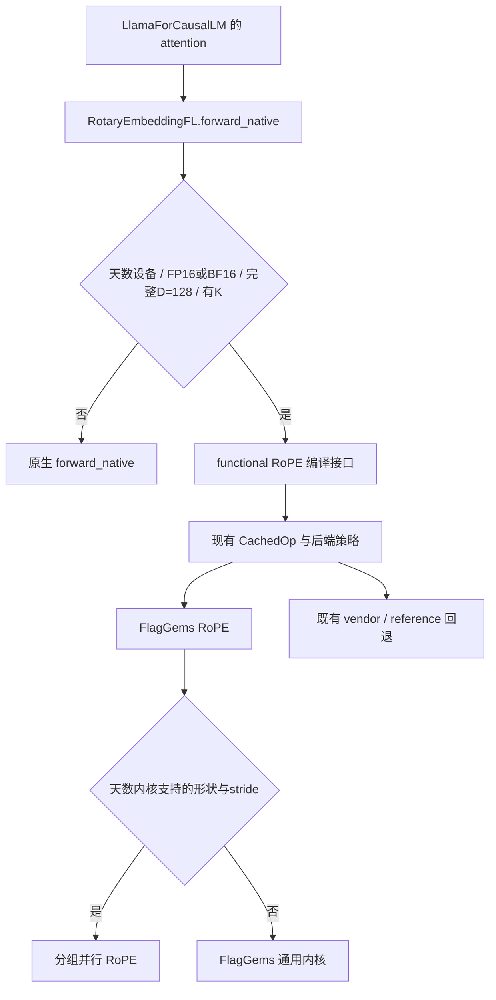

# RoPE 优化前后：从独立快内核到真实模型执行

本文对应 EXP-0002 与 EXP-0004。目标是在 MiniCPM5-2B、天数 BI-V150 上，保持模型、数据类型、官方服务参数和评测脚本不变，测量 RoPE 改动对整模吞吐与 TTFT 的影响。最终数值以 EXP-0004 的结果表、原始轮次和完整性检查为准；文档不会把单算子加速写成端到端收益。

## 1. 优化前有两条不同的路径

第一条是 FlagGems 的通用 RoPE 内核。原实现给每个 token 分配一个 program，再依次循环处理 16 个 Q head 和 2 个 K head。我们最初针对它做了按 head 分组的原型：64-token BF16 微基准由 5.450 µs 降到 2.394 µs，约 2.28 倍。这一结果只说明原型比该通用内核快。

第二条才是官方参数下模型实际使用的路径。vLLM 在 Inductor 编译模式下默认配置为 `custom_ops=['none']`。即使插件注册了 RotaryEmbeddingFL，forward 仍会选到继承的 forward_native。已检查的基线编译图中，RoPE 展开为位置索引、拆分 cos/sin、旋转乘加和拼接；它没有调用之前测试的 FlagGems RoPE。

因此，直接把 2.28 倍写成模型优化幅度会比较错对象。EXP-0004 同时增加“新接入路径对编译后 native RoPE”的局部测量与真实 HTTP 服务 A/B。

## 2. 内核改了什么

对一对旋转分量 a、b，计算保持为：

```text
lower = a * cos - b * sin
upper = b * cos + a * sin
```

NeoX 布局的 a、b 分别来自 head 的前后半段；交错布局来自相邻偶数、奇数位置。没有改变位置编号、RoPE theta、模型权重或缓存数值。

| 方面 | 通用实现 | 分组并行实现 |
| --- | --- | --- |
| program 划分 | 每个 token 一个 program | token × head group |
| head 处理 | 循环遍历 Q/K 的各个 head | 一次处理 BH 个 head，Q/K 分组共享一次 launch |
| 旋转元素 | 每个输出读取自身和旋转伙伴 | 同一 lane 读取 a、b 后计算两个输出 |
| 输入布局 | 通过 stride 读取 | 同样支持 QKV 投影切片的 stride |
| 输出布局 | 通用实现分别支持原地/独立输出 | 共用一份算术，传入独立输出指针和 stride |
| 未覆盖形状 | 通用路径 | 明确回退到原通用路径 |

例如 BH=8、Q/KV=16/2 时，每个 token 对应三个 program：两个处理 Q，一个处理 K。这样增加了小批次的并行任务数，也减少了 program 内逐 head 的循环。每一对旋转元素在写回前都已读取，避免原地更新时后续读到已覆盖值。逻辑上的重复输入读取减少，不等于已经证明实际显存流量减少一半；缓存和编译结果仍会影响最终性能。

BH 的选择来自 EXP-0002 已保存的 sweep：1-token 用 2，2–8-token 用 4，9–128-token 用 8，更大批次用 16，固定 4 warps。服务期间没有额外 autotune，也没有按官方评测结果临时调整服务参数。

## 3. 为什么接入时增加独立输出

最初原型直接改写 Q/K。但真实模型的 Q、K、V 可能共享 QKV 投影输出，编译器还要分析哪些张量被读写。如果把原地改写藏在一个声明不修改输入的接口里，计算图可能错误重排操作，或在 Graph replay 中出现难以复现的问题。

新内核保留原地形式用于原接口，同时增加独立输出形式。模型编译接入使用独立输出，不修改 QKV；fake/meta 实现描述同样的输出形状、dtype、设备和连续布局。验证同时检查数值、原始 QKV 是否逐位保持、V 切片是否保持以及 Graph 捕获重放。

## 4. 如何真正进入模型，同时保留调度



推理插件只为已覆盖条件增加可编译的接入点；FP32、partial RoPE、缺省 K 和其他设备仍使用原 native 路径。FlagGems 的后端注册也限定支持范围，其他形状交给原实现。主要后端选择、策略更新、strict 模式、失败回退和 IO-dump 钩子仍通过 CachedOp 执行。

自定义算子是编译边界，边界以内仍执行真实调度。这样既避免 Dynamo 跟踪 Python 管理器状态，也让 CUDA Graph 捕获实际 Triton launch。代价是这一边界可能阻断原来 Inductor 的跨算子融合，prefill 的 Python 调度和输出分配也可能增加成本。因此必须测试实际 compiled-native 基线，不能仅凭通用内核 sweep 选择最终方案。

优化版本使用独立的 VLLM_CACHE_ROOT，以确保重新生成包含新代码的图。服务参数与模型配置不变。实验必须同时看到日志选中 default.flagos、实际模型编译图包含 fl_rotary_embedding_dispatch，才进入正式吞吐测量；只 import 新文件不算接入证明。

## 5. 端到端 A/B 如何控制变量

基线固定为 plugin 13eb9be、FlagGems 官方 v5.3.5 a7620cc。候选代码提交记录在 EXP-0004/versions.json；不合并后续上游优化。

官方服务参数保持不变：FULL_DECODE_ONLY、显存比例 0.85、max-model-len 131072。使用原封不动的 benchmark 脚本，并在运行前后校验其 SHA256。两组用例为 `[4096,1024,64,256]` 和 `[16384,1024,64,128]`，每组四轮，按官方逻辑舍弃第一轮并汇总后三轮。

GPU 测量串行执行。EXP-0003 已完成 4K 基线四轮，16K 在讨论评测耗时期间被中止，没有完成有效轮次。用户明确要求继续使用官方数据集配置，因此保留完整的 4K 基线，用原官方 16K 配置重跑完整四轮，再执行候选两组官方负载。两组基线来自不同服务会话，结果保存来源，不称作一次连续完整运行。候选先做基本接入及模型编译预检；正式服务重新启动，只做与原基线相同的 32-token smoke。没有启动短负载 A/B，也不再运行额外八条短生成对照。

完整性检查不仅查看退出码，还要求两个场景、八条原始结果、各轮全部请求成功，以及输入/输出 token 总数准确。报告同时保留三轮吞吐分布和变异系数。吞吐变化按 `(candidate / baseline - 1) × 100%` 计算；TTFT 变化也按相同比率计算，正数代表延迟变差。

按用户当前安排，完整 MATH500 Level 3 精度评测暂不运行，也不在本次自动实验队列中。保留基本数值、输入完整性、编译和 Graph 可运行性检查；短生成诊断只记录输出差异，不能代替完整任务精度评测。精度状态明确记为 deferred_by_user。

## 6. 怎样解释结果

结果分为三层：通用 FlagGems 内核对比、实际编译 RoPE 局部对比、HTTP 整模对比。只有最后一层能回答该修改是否改善赛事吞吐与 TTFT。

如果 RoPE 原本只占总时长的比例 p，而该部分加速为 s，理想整体加速上限为 `1 / (1 - p + p/s)`；这还没有计入新增调度、分配和融合边界成本。因此，小于波动幅度的变化应标为“尚不能证明正收益”，出现回退也如实保留。不会因期待加速而挑选最好的一轮或省略变慢的场景。

本轮性能判定回答：新内核是否真实执行、基本接入检查是否通过、两组整模吞吐变化多大、TTFT 是否退化，以及收益是否大于本次测量波动。完整任务精度按用户安排暂缓；因此本轮即便性能通过，也不声称已完成赛事全部验证。最终结果和失败尝试均记录在 EXP-0004，PR 保持草稿状态。
